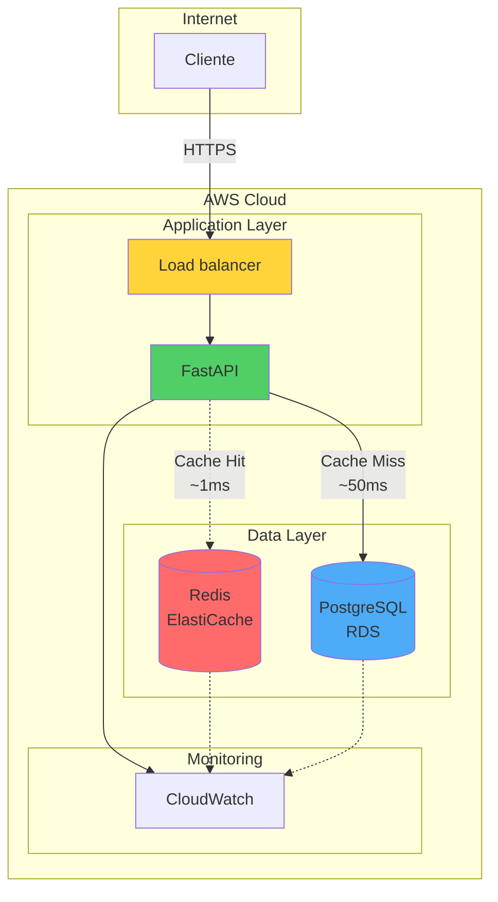
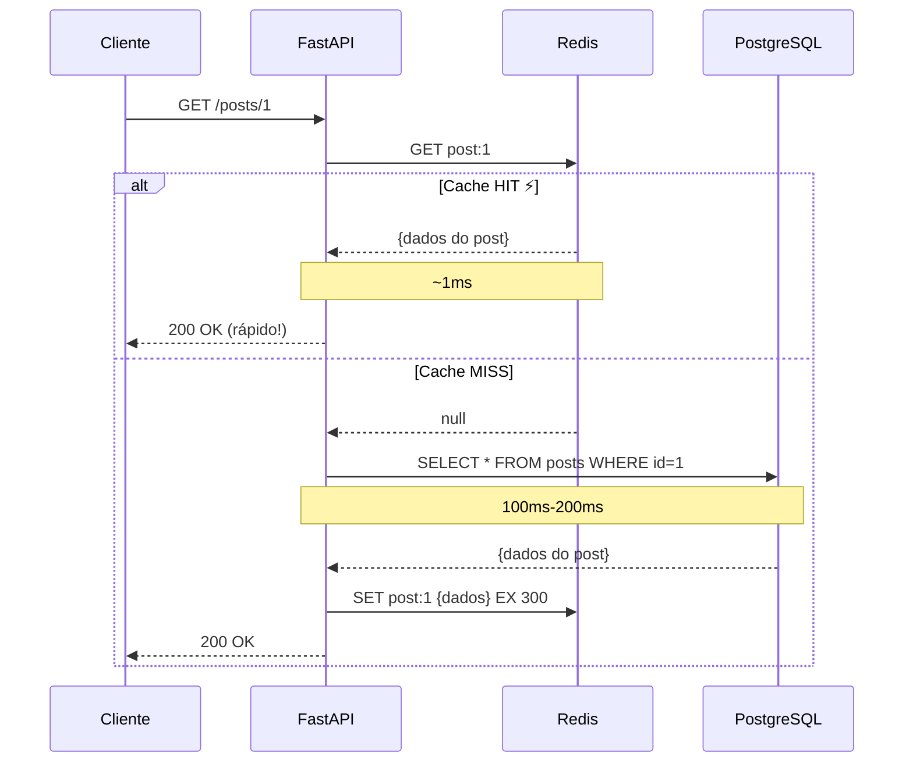
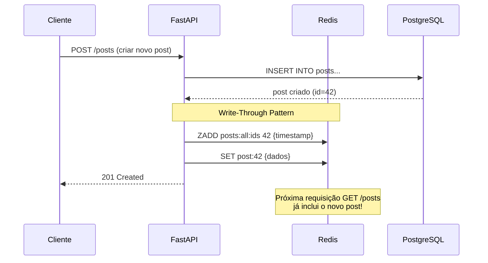
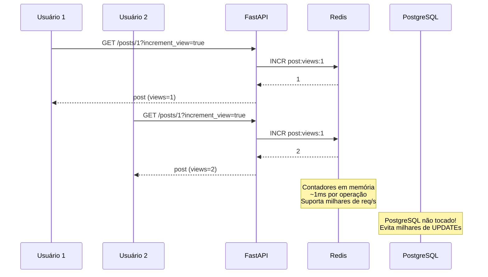
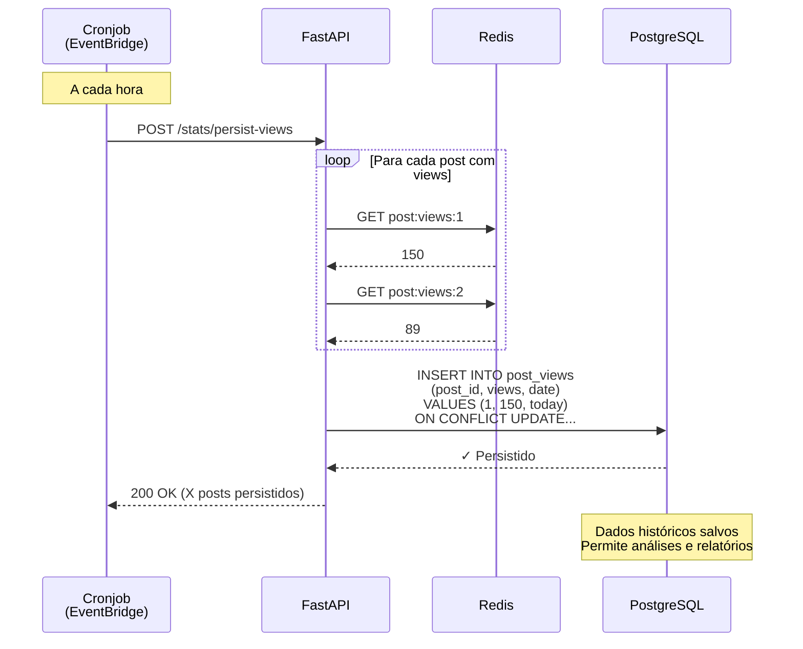
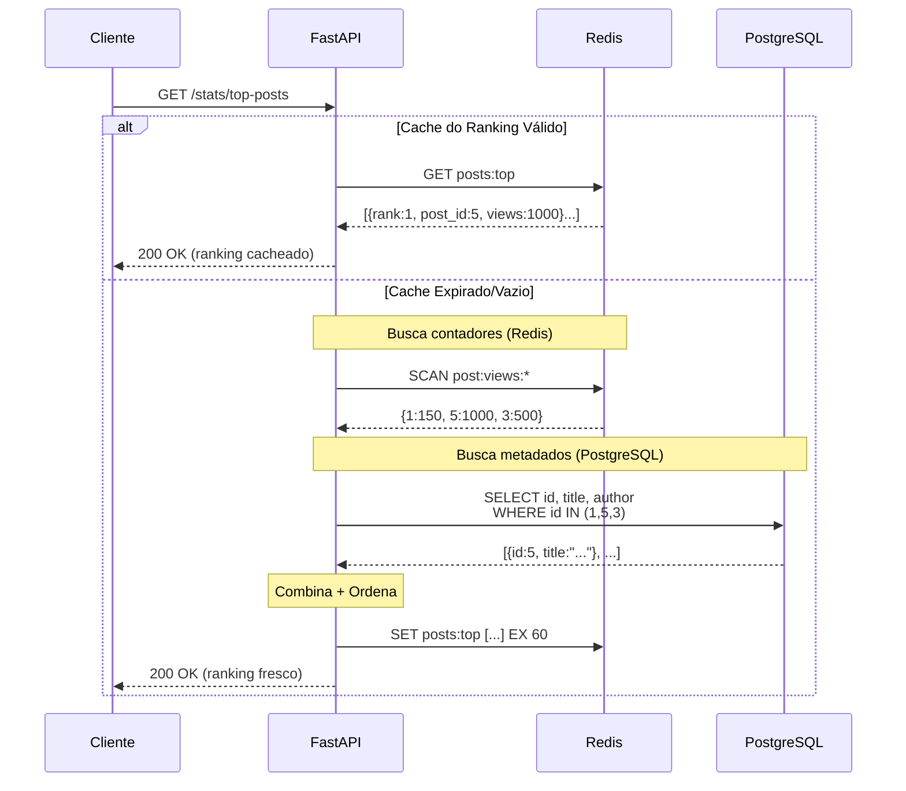

# 🚀 Workshop: Engenharia de Dados na AWS

Sistema de Blog demonstrando integração **PostgreSQL (RDS)** + **Redis (ElastiCache)**

---

## 📋 Índice

- [Sobre o Projeto](#sobre-o-projeto)
- [Arquitetura](#arquitetura)
- [Padrões Demonstrados](#padrões-demonstrados)
- [Tecnologias](#tecnologias)
- [Setup Rápido](#setup-rápido)
- [Testando a API](#testando-a-api)
- [Deploy na AWS](#deploy-na-aws)

---

## 🎯 Sobre o Projeto

Este é um **showcase prático** para workshops de engenharia de dados, demonstrando como integrar banco de dados relacional (PostgreSQL) com sistema de cache (Redis) para criar APIs de alta performance.

### O que você vai aprender:

✅ Padrões de cache (Cache-Aside, Write-Through)
✅ Contadores em tempo real com Redis
✅ Persistência assíncrona de dados
✅ Agregação e rankings dinâmicos
✅ Health checks para cloud environments
✅ Boas práticas de arquitetura AWS

---

## 🏗️ Arquitetura



### Componentes AWS (Produção):

- **Amazon RDS (PostgreSQL)**: Dados persistentes, transações ACID, análise histórica
- **Amazon ElastiCache (Redis)**: Cache de alta velocidade, contadores em tempo real, dados temporários
- **Amazon ECS / Lambda**: Hospedagem da aplicação (containers ou serverless)
- **Application Load Balancer**: Distribuição de tráfego entre instâncias
- **CloudWatch**: Monitoramento, logs e alertas

---

## 💡 Padrões Demonstrados

### 1️⃣ Cache-Aside (Lazy Loading)

**Endpoint**: `GET /posts` e `GET /posts/{id}`



**Benefício**: Reduz latência de ~50ms para ~1ms (50x mais rápido!)

---

### 2️⃣ Write-Through + Cache com Sorted Sets

**Endpoints**: `POST /posts`, `PATCH /posts/{id}`, `DELETE /posts/{id}`



**Benefício**: Novo post aparece imediatamente sem reconstruir cache inteiro

---

### 3️⃣ Contadores em Tempo Real

**Endpoint**: `GET /posts/{id}?increment_view=true`



**Benefício**: Performance escalável - 1000x mais rápido que UPDATE no PostgreSQL

---

### 4️⃣ Persistência Assíncrona

**Endpoint**: `POST /stats/persist-views` (via cronjob/Lambda)



**Benefício**: Melhor performance em runtime + dados históricos para análise

---

### 5️⃣ Agregação e Rankings

**Endpoint**: `GET /stats/top-posts`



**Benefício**: Combina velocidade do Redis com dados relacionais do PostgreSQL

---

## 🛠️ Tecnologias

### Backend
- **FastAPI**: Framework web moderno e rápido
- **Python 3.12**: Linguagem de programação
- **Pydantic**: Validação de dados
- **Uvicorn**: ASGI server

### Bancos de Dados
- **PostgreSQL 15**: Banco relacional
- **Redis 7**: Cache in-memory

### DevOps
- **Docker & Docker Compose**: Containerização
- **psycopg2**: Driver PostgreSQL
- **redis-py**: Cliente Redis

---

## ⚡ Setup Rápido

### Pré-requisitos

- Docker e Docker Compose instalados
- Python 3.11+ (apenas se rodar sem Docker)

### 1. Clone e Configure

```bash
# Clone o repositório (ou extraia o zip)
cd led-aws-pg-redis

# Copie as variáveis de ambiente
cp .env.example .env

# (Opcional) Edite .env se necessário
```

### 2. Inicie os Serviços

```bash
# Sobe PostgreSQL, Redis e a API
docker-compose up -d

# Aguarde ~30 segundos para tudo inicializar
```

### 3. Verifique o Status

```bash
# Verifica se serviços estão rodando
docker-compose ps

# Testa health check
curl http://localhost:8000/health
```

### 4. Popule com Dados de Exemplo

```bash
# Instala dependências (se ainda não instalou)
pip install requests

# Executa script de seed
python seed_data.py
```

Isso vai criar:
- 3 autores
- 7 posts sobre engenharia de dados
- ~675 visualizações simuladas

### 5. Acesse a Aplicação

**Frontend Web**: http://localhost:8000

Você verá uma interface web moderna com:
- Dashboard com estatísticas em tempo real
- Grid de posts navegável
- Ranking dos posts mais visualizados
- Visualização de posts com contador de views automático

**API Swagger UI**: http://localhost:8000/api/docs

Documentação interativa com todos os endpoints da API!

---

## 🧪 Testando a Aplicação

### Via Interface Web (Recomendado para Demonstração)

1. Acesse http://localhost:8000
2. Navegue pelos posts no grid
3. Clique em um post para ver detalhes (incrementa views automaticamente)
4. Acesse "Top Posts" para ver o ranking em tempo real
5. Observe as estatísticas sendo atualizadas dinamicamente

### Via Swagger UI (Recomendado para Testes de API)

1. Acesse http://localhost:8000/api/docs
2. Explore os endpoints
3. Clique em "Try it out" para testar
4. Veja as respostas em tempo real

### Via curl

```bash
# Lista todos os posts
curl http://localhost:8000/posts

# Lista apenas publicados
curl http://localhost:8000/posts?published_only=true

# Busca post específico (incrementa views)
curl http://localhost:8000/posts/1

# Top posts mais visualizados
curl http://localhost:8000/stats/top-posts

# Views de um post específico
curl http://localhost:8000/stats/post/1/views

# Cria novo autor
curl -X POST http://localhost:8000/authors/ \
  -H "Content-Type: application/json" \
  -d '{
    "name": "Seu Nome",
    "email": "seu@email.com",
    "bio": "Sua bio aqui"
  }'

# Cria novo post
curl -X POST http://localhost:8000/posts/ \
  -H "Content-Type: application/json" \
  -d '{
    "title": "Meu Post",
    "slug": "meu-post",
    "content": "Conteúdo do post...",
    "summary": "Resumo",
    "author_id": 1,
    "published": true
  }'
```

### Demonstrando Cache em Ação

```bash
# 1ª chamada (cache MISS - mais lenta)
time curl http://localhost:8000/posts

# 2ª chamada (cache HIT - muito mais rápida!)
time curl http://localhost:8000/posts

# Compare os tempos! 🚀
```

### Testando Contadores

```bash
# Visualiza post várias vezes
for i in {1..10}; do
  curl http://localhost:8000/posts/1?increment_view=true
done

# Verifica contadores
curl http://localhost:8000/stats/top-posts
```

---

## 📊 Monitorando Redis

```bash
# Conecta no Redis
docker exec -it blog-redis redis-cli

# Comandos úteis:
> KEYS *              # Lista todas as chaves
> GET post:1          # Ver cache de um post
> GET post:views:1    # Ver contador de views
> TTL post:1          # Ver tempo restante de cache
> DBSIZE              # Tamanho do banco
```

---

## 🗄️ Acessando PostgreSQL

```bash
# Conecta no PostgreSQL
docker exec -it blog-postgres psql -U postgres -d blogdb

# Comandos úteis:
\dt                           # Lista tabelas
SELECT * FROM authors;        # Ver autores
SELECT * FROM posts;          # Ver posts
SELECT * FROM post_views;     # Ver views persistidas

# Query útil: posts com mais views (do PostgreSQL)
SELECT p.title, SUM(pv.views_count) as total_views
FROM posts p
LEFT JOIN post_views pv ON p.id = pv.post_id
GROUP BY p.id, p.title
ORDER BY total_views DESC
LIMIT 10;
```

---

## ☁️ Deploy na AWS

### Recursos Necessários

1. **VPC** com subnets públicas e privadas
2. **RDS PostgreSQL** (ex: db.t3.micro para testes)
3. **ElastiCache Redis** (ex: cache.t3.micro)
4. **ECS Cluster** com Fargate ou EC2
5. **Application Load Balancer**
6. **ECR** para armazenar imagem Docker

### Passo a Passo Resumido

```bash
# 1. Build e push da imagem
docker build -t blog-api .
aws ecr get-login-password --region us-east-1 | docker login --username AWS --password-stdin ECR_URL
docker tag blog-api:latest ECR_URL/blog-api:latest
docker push ECR_URL/blog-api:latest

# 2. Crie RDS PostgreSQL
# - Via console ou Terraform
# - Guarde endpoint e credenciais

# 3. Crie ElastiCache Redis
# - Via console ou Terraform
# - Guarde endpoint

# 4. Execute schema no RDS
psql -h RDS_ENDPOINT -U postgres -d blogdb -f schema.sql

# 5. Deploy ECS Task
# - Configure variáveis de ambiente com endpoints
# - Deploy via console, CLI ou Terraform
```

### Variáveis de Ambiente (Produção)

```bash
DATABASE_HOST=your-rds-endpoint.rds.amazonaws.com
DATABASE_PORT=5432
DATABASE_NAME=blogdb
DATABASE_USER=postgres
DATABASE_PASSWORD=<use_secrets_manager>

REDIS_HOST=your-elasticache.cache.amazonaws.com
REDIS_PORT=6379
REDIS_DB=0

DEBUG=False
```

⚠️ **Importante**: Use **AWS Secrets Manager** para senhas em produção!

---

## 📁 Estrutura do Projeto

Arquitetura organizada e escalável:

```
led-aws-pg-redis/
├── frontend/                      # 🎨 Interface Web
│   ├── index.html                 # Página principal
│   ├── css/
│   │   └── style.css              # Estilos da aplicação
│   └── js/
│       └── app.js                 # Lógica do frontend
│
├── src/
│   ├── main.py                    # 🚀 Entry point da aplicação
│   │
│   ├── core/                      # ⚙️ Core - Infraestrutura
│   │   ├── __init__.py
│   │   ├── config.py              # Configurações e Settings
│   │   └── database.py            # Managers PostgreSQL + Redis
│   │
│   ├── models/                    # 📋 Schemas Pydantic
│   │   ├── __init__.py
│   │   ├── author.py              # Schemas de Author
│   │   ├── post.py                # Schemas de Post
│   │   └── common.py              # Schemas comuns (Health, etc)
│   │
│   ├── services/                  # 💼 Lógica de Negócio
│   │   ├── __init__.py
│   │   ├── author_service.py     # CRUD de autores + cache
│   │   ├── post_service.py       # CRUD de posts + cache patterns
│   │   └── stats_service.py      # Métricas e rankings
│   │
│   ├── routes/                    # 🛣️ Endpoints da API
│   │   ├── __init__.py
│   │   ├── authors.py             # GET/POST /authors
│   │   ├── posts.py               # GET/POST/PATCH/DELETE /posts
│   │   └── stats.py               # GET /stats/*
│   │
│   └── utils/                     # 🔧 Utilitários
│       ├── __init__.py
│       └── cache.py               # Constantes de cache e TTLs
│
├── docker-compose.yml             # 🐳 Orquestração local
├── Dockerfile                     # 📦 Imagem da aplicação
├── requirements.txt               # 📚 Dependências Python
├── schema.sql                     # 🗄️ Schema do PostgreSQL
├── seed_data.py                   # 🌱 Script de dados de exemplo
├── .env.example                   # 🔐 Template de variáveis
├── PATTERNS.md                    # 📚 Padrões avançados (referência)
└── README.md                      # 📖 Esta documentação
```

### Princípios da Arquitetura:

- **Separation of Concerns**: Cada camada tem responsabilidade única
- **Dependency Injection**: FastAPI Depends para gerenciar conexões
- **Single Responsibility**: Cada service gerencia uma entidade
- **Scalability**: Fácil adicionar novos services, models e routes

---

## 🔧 Troubleshooting

### API não sobe

```bash
# Veja os logs
docker-compose logs api

# Reinicie os serviços
docker-compose restart
```

### PostgreSQL não conecta

```bash
# Verifica se está rodando
docker-compose ps postgres

# Testa conexão
docker exec -it blog-postgres pg_isready
```

### Redis não conecta

```bash
# Verifica se está rodando
docker-compose ps redis

# Testa conexão
docker exec -it blog-redis redis-cli ping
```

### Porta já em uso

```bash
# Mude as portas no docker-compose.yml
# Ex: "8001:8000" ao invés de "8000:8000"
```

---

## 📚 Recursos Adicionais

### Documentação AWS
- [Amazon RDS para PostgreSQL](https://docs.aws.amazon.com/rds/latest/userguide/CHAP_PostgreSQL.html)
- [Amazon ElastiCache for Redis](https://docs.aws.amazon.com/elasticache/latest/red-ug/)
- [AWS Well-Architected Framework](https://aws.amazon.com/architecture/well-architected/)

### Padrões de Cache
- [Caching Strategies (AWS)](https://aws.amazon.com/caching/best-practices/)
- [Redis Best Practices](https://redis.io/docs/management/optimization/)

### FastAPI
- [Documentação FastAPI](https://fastapi.tiangolo.com/)
- [Pydantic](https://docs.pydantic.dev/)

---

## 📝 Licença

MIT License - use livremente para workshops, estudos e produção!

---

## 🎤 Sobre o Workshop

Este showcase foi criado para demonstrar de forma prática e didática como integrar PostgreSQL e Redis em aplicações modernas, seguindo best practices da AWS.

**Bom workshop! 🚀**

